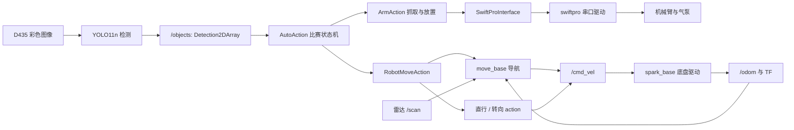
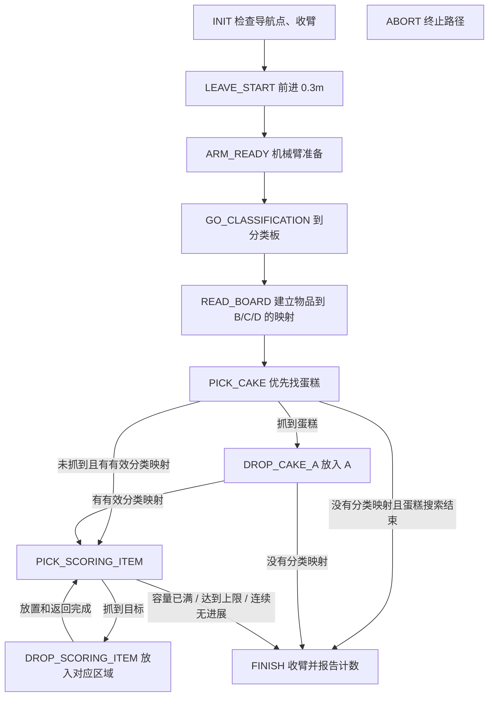

# 核心代码与运行逻辑

维护者确认：原机器人工作区中的程序已经在机器人上运行过。这里解释的是该工作区的源码与当前配置；本次整理在 Windows 上完成，没有连接机器人重跑，也没有据此断言每个历史版本、可选功能或所有比赛场景均通过实测。

## 1. 从哪里开始读代码

| 功能 | 核心文件 | 主要入口 |
|---|---|---|
| 自动赛总调度 | [runtask.py](../robot/auto_2026/auto_match/nodes/runtask.py) | AutoAction.run_task、state_* |
| YOLO → ROS 检测消息 | [yolo_detect_ros.py](../robot/auto_2026/auto_match/nodes/yolo_detect_ros.py) | YoloDetectorNode.image_cb |
| 图像坐标 → 抓取坐标 | 同一 runtask.py | ArmAction.detection_to_arm_target |
| 候选选择、抓取、抓后检查 | 同一 runtask.py | select_best_target、execute_grasp_target |
| 导航和底盘微调 | 同一 runtask.py | RobotMoveAction、goto_task_mark |
| 场地规则与实机参数 | [items_config.yaml](../robot/auto_2026/auto_match/config/items_config.yaml) | full_rule、grasp_profiles |
| 启动编排 | [auto_match.launch](../robot/auto_2026/auto_match/launch/auto_match.launch) | 默认 YOLO、D435、YDLIDAR G6 |
| 初始定位 | [auto_initial_pose.py](../robot/auto_2026/auto_match/nodes/auto_initial_pose.py) | AutoInitialPose.run |
| 记录导航点 | [mark_move.py](../robot/auto_2026/auto_match/nodes/mark_move.py) | 保存/读取 mark_map.pkl |
| 直行和转向 action 服务端 | [spark_move](../robot/auto_2026/spark_move) | b_move_straight_node、b_turnbody_node |
| 底盘驱动 | [spark_base.cpp](../robot/platform/src/spark_base/src/spark_base.cpp)、[spark_base_interface.cpp](../robot/platform/src/spark_base/src/spark_base_interface.cpp) | cmdVelReceived、drive、里程计处理 |
| 机械臂串口驱动 | [swiftpro_write_node.cpp](../robot/platform/src/swiftpro/src/swiftpro_write_node.cpp) | position_write_callback、pump_callback |
| 半自动赛 | [teleop.py](../robot/semi_auto_2024/semi_auto_match_24/scripts/teleop.py)、[grasp.py](../robot/semi_auto_2024/semi_auto_match_24/scripts/grasp.py) | 键盘回路、颜色识别、grasp_cp |

## 2. 自动赛数据流

启动 launch 会启动节点；收到 /task_start_flag 的启动指令后，比赛线程才运行。检测器将每个框的类别 ID、置信度、中心和宽高封装到 Detection2DArray，比赛节点通过 CamAction.detector 按目标类别取结果。六个检测类别是 cake、banana、apple、clock、broccoli、teddybear；当前任务只把 cake、teddybear、clock、banana 作为搬运目标，不能把“模型能识别六类”写成“任务搬运六类”。

## 3. 比赛状态机

INIT 需要当前场地的 Classification_area、Collection_A/B/C/D、Sorting_N 和 Transit_N 等命名点。缺点、关键导航失败、不可达放置点、停止指令或计时保护会使相应状态进入 ABORT。普通一次未找到物体会重试或转入后续流程，不能将所有抓取失败都描述成整场终止。

run_task 每次建立新的 context，保存物品映射、各区域数量、各类别数量、手持物品、已投放计数和连续无进展轮数。计数来自程序执行结果；没有独立的裁判计分反馈。

## 4. 分类板如何决定 B/C/D

实现：AutoAction.detect_board_order_once、detect_board_mapping。

1. 只检测当前 scoring_objects 中的 teddybear、clock、banana。
2. 每轮采集 8 次检测结果，保留置信度不低于 0.45 且位于板区 ROI 的框；当前 ROI 为 x=60–580、y=0–250。
3. 跨采样结果按类别去重，每类保留置信度最高的一个框。这里没有多数投票。
4. 三类必须齐全，按框中心 x 从左到右排序，并要求相邻中心至少间隔 30 像素。
5. 左、中、右分别映射到 Collection_B、Collection_C、Collection_D；映射以运行时识别结果为准。
6. 识别不全时按 0、-8、8、-16、16 度的扫描偏角尝试，每个偏角最多 3 轮。当前 strict_board_required=true，最终失败返回空映射。主流程仍会尝试固定送 A 区的蛋糕，之后结束普通物品搬运。

这些像素阈值与当前相机画幅/安装姿态相关，调整图像分辨率后需要重新检查。

## 5. 导航与北侧抓取策略

RobotMoveAction 从 auto_match/config/mark_map.pkl 读取命名点，将保存的变换矩阵转成 map 坐标系 Pose，再向 move_base 发送 MoveBaseGoal。到点后，指定任务点还会按记录朝向做角度细调：当前容差 3 度，单次修正幅度上限 25 度。

当前配置 north_only.enabled=true、sorting_points=[Sorting_N]。机器人围绕北侧点执行抓取；当没有检测到物体、目标太远或没有可接受目标时，允许将北侧运行时抓取点每次推进 0.03m，累计上限 0.25m。抓取尝试结束后按当前配置后退 0.38m；放置完成后回到 Transit_N，开始下一轮。

源码有 Transit_N/E/S/W 环形绕行能力，但当前 navigation.enabled=false，因此不能把完整环形绕行描述为默认正在执行的策略。B/C 区的侧向脱离动作由 drop_side_escape 单独配置。

直行和转向不是只向底盘发一次定时速度：比赛节点调用 move_straight/turn_body action，服务端使用里程计、激光距离或姿态反馈按各自实现计算完成条件，然后发 /cmd_vel。

## 6. 从检测框到吸取动作

ArmAction 在启动时读取机器人用户目录下的 $HOME/thefile.txt，按空白分隔解析四个数 kx、bx、ky、by。以像素中心 u、v 及类别偏置得到：

    target_u = u + u_offset
    target_v = v + v_offset
    arm_x = kx * target_v + bx + x_offset
    arm_y = ky * target_u + by + y_offset

机械臂坐标和高度的单位是 mm。z、接近高度、抬升高度来自 grasp_profiles。蛋糕使用单独的第二层抓取高度：当前 z=30，而默认普通物品 z=-62。

候选物体会先检查工作空间与接近/接触/抬升三个姿态的逆解，再分为舒适区候选和后备候选。优先在舒适区选择最高分；没有舒适区候选时再考虑可接受的后备目标。评分为：置信度加权值，减去 x/y 到理想位置的偏差与边缘惩罚，具体权重由 YAML 配置。

执行顺序为“到上方 → 下降接触 → 开泵吸取 → 等待吸附 → 抬升 → 移开机械臂 → 视觉检查 → 转到携带姿态”。机械臂动作等待依据指令位置间距离及估计速度计算，并设上下界；驱动回报的是指令位置，不能据此声称收到了实际到位反馈。

抓后检查比较同类目标在原像素位置附近的距离和 IoU；当前要求连续 2 次采样没有匹配原位置目标才通过。该检查是视觉启发式判断，并非吸附压力或物体在手传感器。检测等待失败也可能产生空检测，所以这一结果不能单独当成硬件抓取成功证明。

**标定文件要从原机器人迁移。** 仓库中的 cali_node.py 仍写向 spark_hm_task_match/config/cali_config.yaml，格式也与当前 runtask.py 读取的四数字文本不同。它是遗留标定工具，不能直接把其 YAML 输出重命名为 thefile.txt。这里保留原代码并记录这一接口差异。

## 7. 放置与堆叠

蛋糕固定放 Collection_A；其余三类依据分类板映射放 B/C/D。当前容量 A=1、B/C/D 各 3，普通物品总上限 max_scoring_items=9。达到区域或类别限额后，active_drop_map 会将其从下一轮候选中移除。

ArmAction.drop_pose_for_stack 按该堆已放数量 n 计算放置高度：

    release_z = min(base_z + n * stack_step_z, max_z)
    hover_z = min(release_z + hover_margin_z, max_hover_z)

当前 base_z=-50、stack_step_z=110、max_z=150，前三次释放高度为 -50、60、150mm。select_scoring_drop_target 当前始终选择固定 main 点 (300,-30)，先检查释放和悬停姿态的可达性，再执行下降、关泵释放与撤臂。

放置并完成返回后才增加 context 中的投放计数，再回到 PICK_SCORING_ITEM。连续 2 轮没有抓到普通计分物体时结束。

源码虽有 fallback_count、stack_vision.py 和深度视觉参数，当前 select_scoring_drop_target 使用 fixed_main_stack，主任务没有调用 StackVision。当前配置 stack_vision.enabled=false；因此本版本的运行逻辑应写成“固定位置按数量增加高度”，不能声称已启用双堆自动切换或深度闭环校正。

## 8. 底盘和机械臂驱动如何执行

底盘：spark_base.cpp 订阅 /cmd_vel，把 linear.x、angular.z 交给 spark_base_interface.cpp 的 drive，编码为串口指令。驱动解析底盘反馈并发布 /odom、IMU、轮关节及 TF，供定位和运动 action 使用。底盘默认设备为 /dev/sparkBase，串口实现使用 115200 波特率。

机械臂：SwiftProInterface 发布 position_write_topic、pump_topic、swiftpro_status_topic。swiftpro_write_node.cpp 分别转换成 G0 X…Y…Z…、M2231 V1/V0（气泵）、M17/M2019（锁定/释放）等指令，通过 /dev/ttyACM0、115200 波特率发送。该节点发布 SwiftproState_topic 的数据来自指令状态，不是实测到位反馈。

D435 通过 camera_driver_transfer → realsense2_camera 启动；YDLIDAR G6 通过 lidar_driver_transfer → ydlidar_ros_driver 启动并发布激光扫描。对应源码、消息定义、URDF 和 meshes 都在 robot/platform/src；librealsense2 和 YDLidar-SDK 仍是外部系统依赖。

## 9. 半自动赛核心逻辑

半自动赛启动 semi_auto.launch 后，teleop.py 使用 w/a/s/d 控制低速运动，大写对应快速运动，向 /cmd_vel 发布 Twist。g 发布 /grasp 的字符串 0 触发抓取，h 发布 1 触发对应层数的放置。

该版本 grasp.py 使用 HSV 蓝色范围 [95,90,80]–[130,255,255]，随后均值滤波、阈值、闭运算、腐蚀/膨胀和轮廓检测。候选按距图像下方中心 (320,480) 的距离选择，中心变化在 4 像素内累计达到 30 次后标为可抓取。收到抓取指令后，用其标定系数将图像中心换算为机械臂位置，执行吸取；放置由命令携带的层数控制。

这个半自动赛实现没有接入当前 YOLO 节点，也没有自动赛状态机的板区分类与自主搬运循环。两种模式手动话题的值不同，使用前按下表确认。

## 10. 关键接口与运行状态

| 接口 | 数据/约定 | 用途 |
|---|---|---|
| /camera/color/image_raw | sensor_msgs/Image | 默认 D435 彩色图像 |
| /objects | 此仓库 vision_msgs/Detection2DArray | 检测结果；沿用 results[0].id/score 接口 |
| /task_start_flag | std_msgs/String，1/start/run/true；0/stop/false | 自动赛启停线程 |
| /grasp（自动赛） | 1 抓取；0 放置；也支持类别名称抓取 | 任务线程空闲时使用 |
| /grasp（半自动赛） | 0 抓取；1 等数字为放置层数 | g/h 键对应命令 |
| move_straight、turn_body | common 中的 action 类型 | 底盘微调 |
| /get_distance | common/GetFrontBackDistance | 前后激光距离 |
| /cmd_vel | geometry_msgs/Twist | 底盘线速度 m/s、角速度 rad/s |
| position_write_topic | swiftpro/position | 机械臂位置 mm |
| pump_topic | swiftpro/status | 气泵 1 开、0 关 |

当前 debug_disable_time_limit=true 会关闭计时检查。启用计时后，任务以 570s 为配置时限，并检查 15s 结束余量及导航/抓取/放置各自的最低剩余时间。停止会取消导航与微调目标、关闭气泵并尝试收臂；这些是软件停止路径，不应当成独立的硬件急停系统。

auto_initial_pose.py 启动时会发布初始位姿、等待 AMCL、按配置旋转预热、前进脱离并清代价地图，然后发布 /auto_initial_pose_done。当前 run_task 没有订阅该完成话题来强制等待，因此应在定位初始化完成后由操作者发送任务启动指令。
